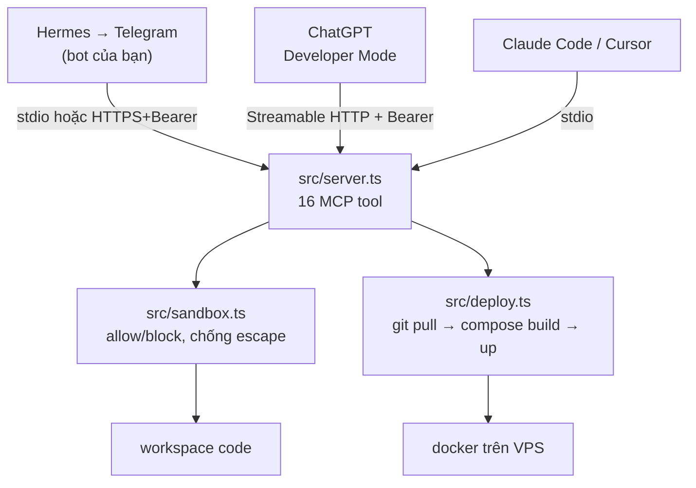

# ChatGPT Code MCP

MCP server tự host, expose một workspace code trong sandbox cho bất kỳ MCP client nào — **Hermes** (Telegram/Discord/CLI), **ChatGPT** Developer Mode, Claude Code, Cursor — và cho phép client **deploy** lại chính VPS đó.

Không cần gateway, không cần pairing, không cần dịch vụ bên thứ ba.

## Kiến trúc



Mọi tool filesystem đi qua đúng một cửa: `resolvePath()` trong `src/sandbox.ts`. Ngoại lệ duy nhất là `deploy` — nó chạy `git`/`docker` trên host, nên **mặc định tắt**.

## Yêu cầu

- Node.js 22+ (test trên 24)
- pnpm 10+ (repo pin `packageManager: pnpm@10.33.0`)
- ripgrep (`rg`) — tùy chọn; thiếu thì `code_search` tự chuyển sang scanner nội bộ
- Git — cho `git_status` / `git_diff` / `git_log` / `deploy`
- Docker + compose — chỉ khi dùng `deploy`

```bash
pnpm install
```

## Chạy local

### stdio

```bash
pnpm mcp:stdio --workspace-root .
```

`stdout` là kênh JSON-RPC; mọi log đi ra `stderr`.

### HTTP

```bash
MCP_AUTH_TOKEN=$(openssl rand -hex 32) pnpm mcp:http --port 8787 --workspace-root .
curl -s localhost:8787/healthz
```

Endpoint MCP: `POST/GET/DELETE /mcp`. Health: `GET /healthz`.

> Cả hai script nhận `--workspace-root` có hoặc không có `--` phía trước (pnpm 10 forward `--` vào script, npm thì cần nó).

## Kết nối Hermes

Hermes đọc MCP server từ key `mcp_servers` trong `~/.hermes/config.yaml`. Có hai cách, chọn theo chỗ Hermes chạy.

### A. Hermes chạy cùng máy với code — dùng stdio (khuyến nghị)

Đơn giản nhất: không TLS, không token, không tunnel.

```yaml
mcp_servers:
  code:
    command: 'node'
    args:
      - '/srv/chatgpt-code-mcp/dist/bin/stdio.js'
      - '--workspace-root'
      - '/srv/code'
    env:
      DEPLOY_ENABLED: 'true'
      DEPLOY_REPO_DIR: '/srv/chatgpt-code-mcp'
```

Hoặc bằng CLI:

```bash
hermes mcp add code --command node --args /srv/chatgpt-code-mcp/dist/bin/stdio.js --workspace-root /srv/code
```

### B. Hermes chạy máy khác — dùng HTTP + bearer

```yaml
mcp_servers:
  code:
    url: 'https://mcp.example.com/mcp'
    headers:
      Authorization: 'Bearer <MCP_AUTH_TOKEN>'
```

```bash
hermes mcp add code --url https://mcp.example.com/mcp
```

### Sau khi sửa config

```bash
/reload-mcp
```

Nếu tool không hiện trong session Telegram đang chạy, **restart hẳn process Hermes** — cache tool MCP có thể bị stale qua các session sống lâu.

### Giới hạn tool cho Hermes

Bot Telegram có thể xoá file và deploy. Nên chỉ bật đúng thứ cần:

```yaml
mcp_servers:
  code:
    command: 'node'
    args: ['/srv/chatgpt-code-mcp/dist/bin/stdio.js', '--workspace-root', '/srv/code']
    tools:
      include:
        - workspaces_list
        - directory_list
        - file_read
        - code_search
        - file_apply_patch
        - git_diff
        - test_run
        - deploy
```

Chính doc của Hermes cũng cảnh báo: server có khả năng mutate thì đừng nối vào Telegram/Discord/cron trước khi đã kiểm tra approval gate và đường rollback.

Nhắn thử:

```text
Đọc src/greeting.ts rồi sửa greet trả về "Hello, <name>! Welcome to MCP.", chạy test, xong thì deploy.
```

## Kết nối ChatGPT

ChatGPT **chỉ nhận remote MCP qua HTTPS**, nên phải có TLS (xem phần VPS bên dưới hoặc tunnel):

```bash
cloudflared tunnel --url http://127.0.0.1:8787
```

Rồi **Settings → Connectors → Advanced → Developer mode**, thêm `https://<host>/mcp` + bearer token.

- **Developer Mode bắt buộc** để dùng tool ghi; mọi write action đều hỏi xác nhận.
- Khi **chưa** bật Developer Mode, ChatGPT reject connector thiếu tool `search` + `fetch`. Server này có đủ cả hai nên được chấp nhận ở cả hai chế độ.

## Deploy lên VPS

Server phải chạy **trên máy có code**. Nó không có agent từ xa — nó chính là thứ đọc filesystem.

Cần deploy: `dist/` đã build + `node_modules` prod + workspace + `MCP_AUTH_TOKEN` + TLS terminator. Không cần `tsx`/`typescript` trên VPS.

### Cách 1: Docker compose (khuyến nghị)

```bash
git clone <repo> /srv/chatgpt-code-mcp && cd /srv/chatgpt-code-mcp
cp .env.example .env && $EDITOR .env     # MCP_AUTH_TOKEN, WORKSPACE_DIR
$EDITOR Caddyfile                        # đổi mcp.example.com thành domain thật
docker compose up -d --build
curl -s localhost:8787/healthz
```

| File | Vai trò |
|---|---|
| `Dockerfile` | Multi-stage: build `dist/`, runtime alpine có `git`, `ripgrep`, `docker-cli`, `tini`, chạy non-root `node` |
| `compose.yaml` | Service `mcp` (bind `127.0.0.1:8787`) + `caddy` (TLS 80/443) |
| `Caddyfile` | Reverse proxy có `flush_interval -1` — **bắt buộc**, thiếu nó Caddy buffer SSE và session MCP treo |
| `.env.example` | Mọi env, kèm ghi chú |

Workspace mount `:ro` mặc định. Muốn agent sửa được code thì bỏ `:ro`.

### Cách 2: systemd (không Docker)

```bash
pnpm install --frozen-lockfile && pnpm build
sudo cp deploy/chatgpt-code-mcp.service /etc/systemd/system/
sudo $EDITOR /etc/systemd/system/chatgpt-code-mcp.service   # thay PLACEHOLDER
sudo install -m 600 .env.example /etc/chatgpt-code-mcp.env
sudo $EDITOR /etc/chatgpt-code-mcp.env
sudo systemctl daemon-reload && sudo systemctl enable --now chatgpt-code-mcp
```

Unit đã có `NoNewPrivileges`, `PrivateTmp`, `ProtectSystem=full`, `ProtectHome`, và `ReadWritePaths` chỉ mở đúng workspace.

### Bật `deploy`

```bash
DEPLOY_ENABLED=true
DEPLOY_HOST_REPO_DIR=/srv/chatgpt-code-mcp
DEPLOY_SERVICES=mcp
DOCKER_GID=$(getent group docker | cut -d: -f3)
```

Rồi bỏ comment hai volume `/repo` và `/var/run/docker.sock` trong `compose.yaml`.

> **Container có docker socket = quyền tương đương root trên host.** Chỉ mount khi bạn chấp nhận rằng ai giữ `MCP_AUTH_TOKEN` (hoặc điều khiển được bot Hermes) đều deploy được máy này. Với stdio + systemd thì không cần socket — process đã chạy trên host.

`deploy` chạy: `git -c safe.directory=<repo> pull --ff-only` → `docker compose build <services>` → `docker compose up -d <services>`. Dừng ở bước đầu tiên khác 0 và trả về log của đúng bước lỗi.

## Workspace

Một thư mục thành workspace khi có `.code-agent.json`. `--workspace-root` nhận chính thư mục đó, hoặc thư mục cha (mọi con cấp 1 có marker đều được nhận). Lặp `--workspace-root` nhiều lần, hoặc set `MCP_WORKSPACE_ROOTS` (`;` trên Windows, `:` trên POSIX).

Config đọc lại mỗi lần gọi `workspaces_list` → thêm workspace không cần restart.

```json
{
  "name": "chatgpt-code-mcp-sample",
  "allowedPaths": ["src/**", "test/**", "package.json", "tsconfig.json", "README.md", ".code-agent.json"],
  "blockedPaths": [".env*", "secrets/**", "**/*.key", "**/*.pem", "node_modules/**"],
  "commands": { "test": "pnpm test", "build": "pnpm build", "typecheck": "pnpm typecheck" },
  "maxFileBytes": 512000,
  "writable": true,
  "commandTimeoutMs": 120000
}
```

| Field | Mặc định | Ý nghĩa |
|---|---|---|
| `name` | tên thư mục | Id workspace dùng trong tool args |
| `allowedPaths` | `["**"]` | Glob được phép đọc/ghi |
| `blockedPaths` | `[]` | Glob bị chặn — **cộng thêm** vào hard-block, không thay thế |
| `commands` | `{}` | Whitelist cho `test_run`; client chỉ truyền **key** |
| `maxFileBytes` | `512000` | Chặn đọc/ghi file quá lớn |
| `writable` | `true` | `false` → workspace read-only qua MCP |
| `commandTimeoutMs` | `120000` | Trần timeout của `test_run` |

Schema `strict`: field lạ báo lỗi config thay vì bỏ qua im lặng. `Dockerfile`/`compose.yaml` cố ý **không** nằm trong allowlist — agent sửa code, không sửa hạ tầng.

## Tool

| Tool | Đọc/Ghi | Mô tả |
|---|---|---|
| `workspaces_list` | đọc | Workspace, policy, command key, vấn đề config |
| `directory_list` | đọc | Duyệt cây, `depth` 1–5; symlink được báo nhưng không đi theo |
| `file_read` | đọc | Nội dung + `sha256` toàn file + `totalLines`; hỗ trợ `startLine`/`endLine`; file binary bị từ chối |
| `code_search` | đọc | ripgrep (fallback scanner nội bộ), hỗ trợ `regex`, `glob`, `caseSensitive` |
| `search` / `fetch` | đọc | Dạng citation ChatGPT yêu cầu |
| `file_create` | ghi | Tạo file, `overwrite` mặc định `false` |
| `file_apply_patch` | ghi | Patch `oldText`/`newText`, khoá bằng `expectedSha256` |
| `file_move` | ghi | Đổi tên/di chuyển, fallback copy khi `EXDEV` |
| `file_delete` | ghi | Xoá file thường (không xoá thư mục) |
| `git_status` | đọc | Branch, ahead/behind, file — đã lọc theo allowlist (`hiddenCount`) |
| `git_diff` | đọc | Diff working tree hoặc `staged`, cắt theo `maxLines` |
| `git_log` | đọc | `--oneline`, tối đa 50 commit |
| `commands_list` | đọc | Command key workspace cho phép |
| `test_run` | ghi | Chạy command đã whitelist; exit code khác 0 trả về như **dữ liệu**, không phải lỗi tool |
| `deploy` | ghi | git pull → compose build → up. **Tắt mặc định**, cần `DEPLOY_ENABLED=true` |

Resource: `workspace://{name}/config` trả policy đã resolve dưới dạng JSON.

Mọi tool có `annotations` (`readOnlyHint`, `destructiveHint`) để client tự gate write action. `deploy` được đánh `destructiveHint: true`.

### Quy trình sửa file

`file_apply_patch` dùng optimistic locking:

1. `file_read` → lấy `sha256`
2. `file_apply_patch` với `expectedSha256` đó
3. Hash lệch → `CONFLICT`, **không ghi gì**; đọc lại rồi patch lại

Trong một lần gọi, các edit là all-or-nothing. `oldText` không khớp → `NO_MATCH`; khớp nhiều chỗ mà không `replaceAll` → `AMBIGUOUS`. Ghi ra file tạm cùng thư mục rồi `rename`.

## Model bảo mật

**Sandbox path** (`src/sandbox.ts`) — mọi tool filesystem qua `resolvePath()`:

- Path phải tương đối. Tuyệt đối và drive letter (`C:/…`) → `INVALID`
- `..` vượt root → `ESCAPE`
- Symlink/junction được `realpath` **trước** khi check → link ra ngoài → `ESCAPE`
- Match glob **case-insensitive**: `SECRETS/x` cũng bị chặn trên Windows/macOS
- Chặn theo cả tổ tiên: `secrets/**` chặn luôn chính `secrets`
- Ngoài `allowedPaths` → `NOT_ALLOWED`; `writable: false` + ghi → `READ_ONLY`
- Hard-block không thể tắt bằng config: `.git/**`, `.env`, `.env.*`, `node_modules/**`, `**/*.pem`, `**/*.key`, `**/*.p12`, `**/*.pfx`, `**/id_rsa*`, `**/id_ed25519*`, `**/.npmrc`, `**/.git-credentials`, `**/.aws/**`, `**/.ssh/**`

`code_search` lọc lại **từng hit** của ripgrep bằng `isAllowed()`, vì ripgrep không biết policy.

**Thực thi command** — `test_run` nhận **key** của `commands`, không nhận command string. argv lấy từ `.code-agent.json`, spawn `shell: false`, `stdin: ignore`, timeout có trần. Không có đường nào để client nội suy chuỗi vào shell.

**deploy** — tên service phải khớp `^[a-zA-Z0-9_.-]+$` và không bắt đầu bằng `-` (chặn smuggle argv kiểu `--privileged`). `safe.directory` chỉ mở cho đúng `DEPLOY_REPO_DIR`, không dùng wildcard `*`.

**HTTP** — `MCP_AUTH_TOKEN` bật bearer auth, so sánh `timingSafeEqual`. Bind ngoài loopback mà **không** có token → in cảnh báo và exit 1. Body giới hạn 4 MB. Mỗi session một `McpServer` riêng.

**Ngân sách output** — payload mỗi tool cắt ở 60k ký tự trên biên giới dòng; `test_run` giữ 20k ký tự **cuối** mỗi stream; `deploy` giữ 8k/step và gói tin nhắn ≤ 3.5k.

Đừng commit token, `.env`, private key vào repo.

## Phát triển

```bash
pnpm typecheck   # tsc --noEmit (gồm cả test)
pnpm test        # node --test, 60 test
pnpm build       # tsc -p tsconfig.build.json → dist/ (chỉ src, không test)
pnpm start       # node dist/bin/http.js
```

| File | Nội dung |
|---|---|
| `src/config.ts` | Schema + loader `.code-agent.json`, hard-block list, khám phá workspace |
| `src/sandbox.ts` | Glob → regex, allow/block/traverse, `resolvePath`, `assertRegularFile` |
| `src/registry.ts` | Tập workspace đang expose, refresh, resolve theo tên |
| `src/result.ts` | Cắt output, `ok`/`okJson`/`fail`, `guard()` để lỗi không phá connection |
| `src/deploy.ts` | Pipeline git + docker compose, không bao giờ throw |
| `src/server.ts` | `createMcpServer()`, `workspaces_list`, resource config, `resolveRoots()` |
| `src/tools/` | `fs.ts`, `search.ts`, `git.ts`, `exec.ts`, `deploy.ts` |
| `src/bin/` | `stdio.ts`, `http.ts` |
| `deploy/` | systemd unit |

Thêm tool mới: viết `registerXxxTools(server, registry)`, lấy workspace bằng `registry.get(args.workspace)`, resolve path bằng `resolvePath()`, bọc handler trong `guard()`, rồi gọi từ `createMcpServer()`.
